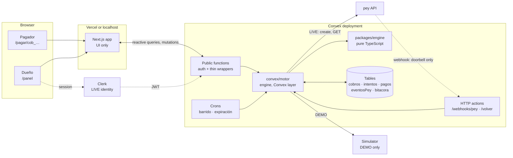
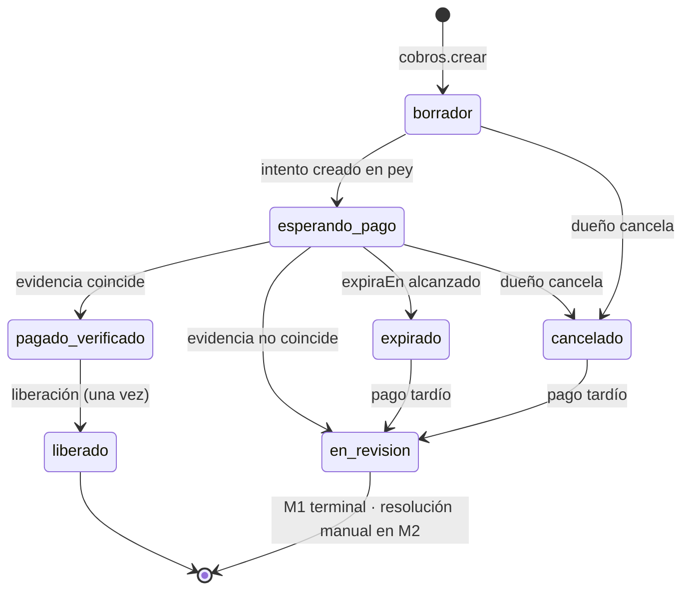
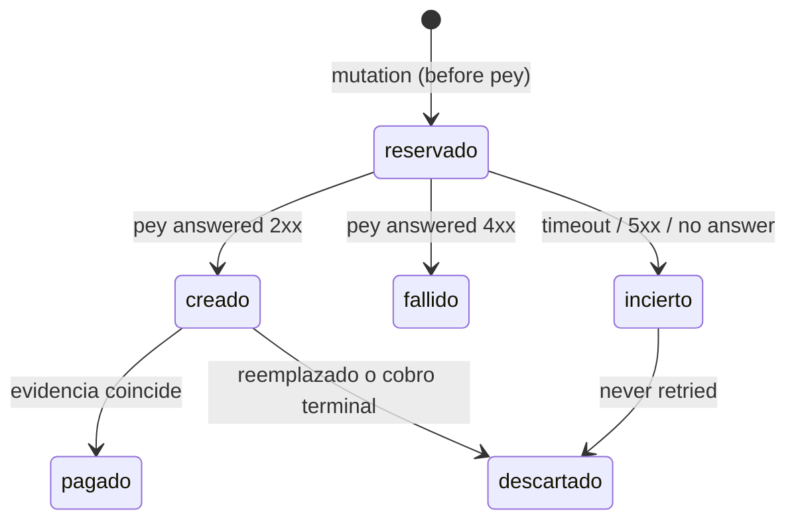
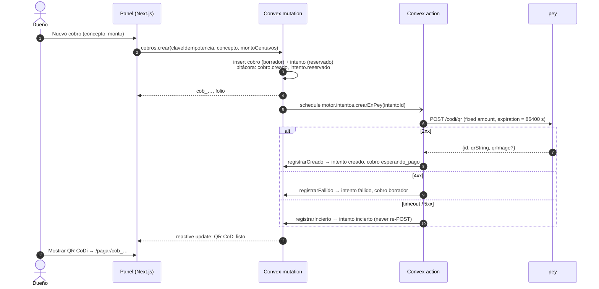
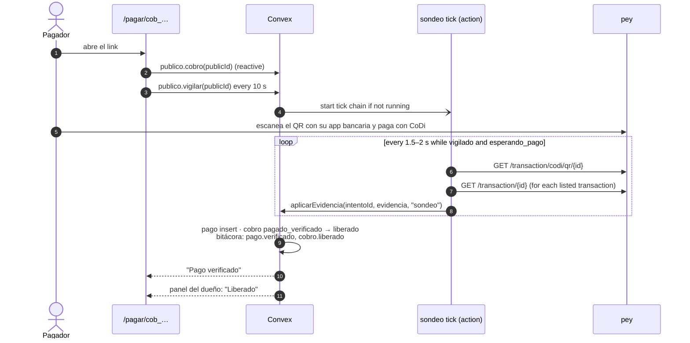
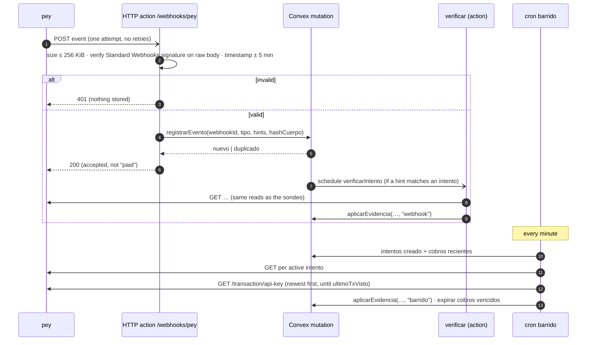
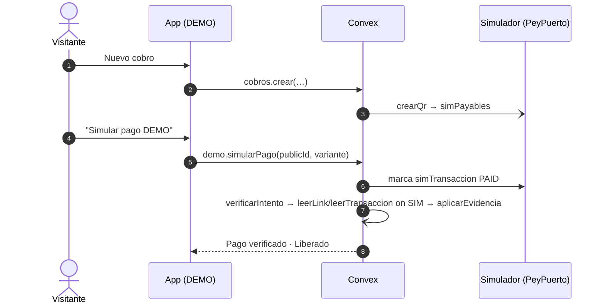

# ARCHITECTURE — PAYVRO OS

Status: design, 2026-11-14. No application code exists yet. This file is the specification builders implement; when code and this file disagree, open a PR that changes one of them on purpose.
Vocabulary: `CONTEXT.md`. Decisions and their reasons: `docs/adr/`.

## 1. Locked stack

| Layer | Choice | Notes |
|---|---|---|
| App | Next.js, App Router, TypeScript strict | Hosted on Vercel, or `next dev` locally. UI only: no pey call and no secret ever lives here. |
| UI kit | Tailwind CSS + shadcn/ui (Radix) | Brand tokens in §9. |
| Identity | Clerk | LIVE only. The pagador never signs in. |
| Backend | Convex | Data, state machine, append-only bitácora, HTTP action for the pey webhook, cron sweep, reactive queries to the UI. |
| Payments | pey API (`https://api.pey.mx`) | CoDi payment links and QR. |
| Tests | Vitest + convex-test, Playwright | |
| Runtime | Node 24, npm, exact versions pinned in `package.json` | WP-OS-01 pins them; do not float. |

Not in M1: Postgres, Rust, a queue, a second service, any AI model on the payment path (ADR-0001).

## 2. Shape



Four pieces, one truth: the payment is true when an authenticated GET to pey says so.

## 3. Repository layout and ownership

```
app/                         Next.js routes. UI only.
  page.tsx                   Home: what this install is, link to panel.
  pagar/[publicId]/          Payer page. Public, no auth.
  panel/                     Owner panel: cobros, nuevo cobro, detalle + bitácora, ajustes.
components/                  UI components (shadcn-based). No data fetching inside ui/.
lib/                         Client helpers: formatting, estado → label/chip, clipboard.
packages/engine/             PURE TypeScript. The portable core.
  src/money.ts               centavos ↔ pesos, checked.
  src/ids.ts                 prefixed id generation and validation.
  src/estados.ts             transition tables for cobro and intento.
  src/verificacion.ts        pure policy: expected + evidence → verdict.
  src/webhook.ts             Standard Webhooks verification (WebCrypto).
  src/pey/tipos.ts           request/response types of the pey API we use.
  src/pey/puerto.ts          PeyPuerto interface (what the engine needs from pey).
  src/pey/cliente.ts         LIVE implementation over an injected fetch.
  src/pey/simulador.ts       DEMO implementation, pure, over an injected store.
  src/index.ts               public exports. Nothing else is imported from outside.
convex/
  schema.ts                  app schema = tablasMotor + app tables.
  motor/                     Convex layer of the engine. Tenant-agnostic.
    tablas.ts                table definitions exported for schema composition.
    cobros.ts intentos.ts    helpers that take (ctx, negocioId, …).
    verificar.ts             aplicarEvidencia + sondeo tick.
    liberar.ts bitacora.ts
    barrido.ts
    peyPuerto.ts             builds the PeyPuerto for a negocio (LIVE client or simulator).
    puertos.ts               interface PuertosMotor that the app must implement.
  puertos.ts                 OS implementation of PuertosMotor (single negocio, key from env).
  cobros.ts panel.ts         public functions for the panel.
  publico.ts                 public functions for the payer page.
  demo.ts                    DEMO-only functions (simular pago).
  negocio.ts                 profile of the single negocio.
  http.ts crons.ts auth.config.ts
tests/                       Vitest: engine unit tests, convex-test state machine tests.
e2e/                         Playwright.
public/brand/                Official brand SVGs. Do not redraw.
docs/                        adr/, wp/, bitacora/.
scripts/                     doctor, sync helpers. No secrets, no network writes without a flag.
```

Hard import rules (lint enforces them, WP-OS-01):
- `packages/engine/**` imports nothing from `convex/`, `app/`, `next`, `@clerk/*`, and reads neither `process.env` nor a global `fetch`. Everything external is injected.
- `convex/motor/**` imports from `packages/engine` and from `convex/puertos.ts` only through the `PuertosMotor` interface. It never reads Clerk identity and never takes `negocioId` from a public argument: the caller resolves it.
- `app/**` and `components/**` never import `packages/engine/src/pey/*` and never touch a `PEY_*` name.

`packages/engine/` and `convex/motor/` together are **the engine**. PAYVRO Cloud consumes exactly those two directories, unmodified (ADR-0008). Anything single-tenant belongs outside them.

## 4. Data model (Convex)

All tables carry `negocioId` and `modo`. In OS there is exactly one `negocios` row; the column still exists so the same engine runs multi-tenant in Cloud (ADR-0003).
Times are epoch milliseconds. Money is integer centavos.

### negocios
| Field | Type | Notes |
|---|---|---|
| `publicId` | `neg_…` | |
| `nombre` | string ≤ 40 | Shown to the pagador. |
| `giro` | enum | `social`, `citas`, `cotizaciones`, `mostrador`, `membresias`, `tienda`. |
| `colorMarca` | enum of 4 brand colors | `#076B76`, `#EF006D`, `#FF7900`, `#142B3B`. |
| `modo` | `demo` \| `live` | Copied from `PAYVRO_MODE` at bootstrap; a mismatch with the env stops every money function. |
| `cobrosPausados` | boolean | Kill switch (M2 UI; the guard exists from WP-OS-02). |
| `folioSiguiente`, `seqBitacora` | number | Counters, updated inside the mutation that uses them. |
| `ultimoTxVisto` | string? | Sweep cursor (pey transaction id). |

The destination account is **not** a field. It is `PEY_BANK_ACCOUNT_ID` in the deployment environment (invariant 5).

### cobros
| Field | Type | Notes |
|---|---|---|
| `publicId` | `cob_…` | Capability for the payer URL. |
| `folio` | number | Per negocio, starts at 1. |
| `plantilla` | `pedido` | More in M2. |
| `concepto` | string ≤ 140 | Untrusted text. Rendered as text, never as HTML, never fed to a tool. |
| `montoCentavos` | integer ≥ 1 | |
| `moneda` | `MXN` | |
| `estado` | cobro state | §5.1. |
| `motivoRevision` | enum? | Set with `en_revision`. |
| `alerta` | `pago_duplicado`? | A liberado cobro that later received a second payment. |
| `intentoActivoId` | id? | At most one. |
| `pagoId` | id? | The verified pago. |
| `expiraEn` | number | Default now + 24 h for `pedido`. Local expiry; pey does not expire links. |
| `claveIdempotencia` | string | Unique per `(negocioId, "cobros.crear")`. |
| `creadoPor` | actor | `{tipo: dueno\|agente\|sistema, id?}`. |
| `creadoEn`, `actualizadoEn`, `verificadoEn?`, `liberadoEn?` | number | |

Indexes: `by_publicId`, `by_negocio_estado`, `by_negocio_folio`, `by_negocio_clave`, `by_estado_expiraEn`.

### intentos
| Field | Type | Notes |
|---|---|---|
| `publicId` | `int_…` | Sent to pey as `clientReferenceId` / `metadata.payvro_intento`. |
| `cobroId` | id | |
| `tipo` | `link` \| `qr` | |
| `estado` | intento state | §5.2. |
| `montoCentavos` | integer | Snapshot of the cobro amount at reservation. |
| `peyPayableId` | string? | Link ULID or QR IDC. |
| `urlPago` | string? | Only `https://app.mipey.mx/payment-link/{id}` is accepted and stored. |
| `qrString` | string? | For `qr`. |
| `destino` | `cuenta_de_la_llave` \| `bank_account_id` | How the destination was fixed at creation (§6.3). |
| `vigiladoHasta` | number? | Sondeo heartbeat deadline. |
| `sondeoActivo` | boolean | True while a tick chain is scheduled. |
| `sondeos`, `ultimaVerificacionEn` | number | Counters instead of one log line per unchanged GET. |
| `claveIdempotencia`, `creadoEn` | | |

Indexes: `by_publicId`, `by_cobro`, `by_peyPayableId`, `by_negocio_estado`, `by_negocio_clave`.

### pagos
One row per pey transaction that PAYVRO evaluated.

| Field | Notes |
|---|---|
| `publicId` `pag_…`, `cobroId`, `intentoId` | |
| `peyTransactionId` | **Unique across the table.** The global claim (invariant 9). |
| `payableType`, `payableId`, `metodo` | As read from pey. |
| `baseCentavos`, `feeCentavos`, `tipCentavos`, `totalCentavos` | |
| `pagadoEn` | pey `datePaid` × 1000. |
| `claveRastreo` | `trackingKey` when present. No other payer bank data is stored. |
| `resultado` | `coincide` \| `monto_distinto` \| `destino_distinto` \| `metodo_no_permitido` \| `con_propina` \| `duplicado` \| `pago_tardio` \| `parcial`. |
| `verificadoEn` | |

Indexes: `by_peyTransactionId`, `by_cobro`.

### eventosPey
| Field | Notes |
|---|---|
| `publicId` `evt_…` | |
| `origen` | `webhook` \| `sondeo` \| `barrido` \| `simulador` \| `retorno`. |
| `webhookId` | Standard Webhooks `webhook-id`. Unique per negocio. Dedup key. |
| `tipo` | Event type string as received (allowlisted). |
| `peyPayableId?`, `peyTransactionId?` | Hints only. |
| `hashCuerpo` | SHA-256 of the raw body. The body itself is not stored. |
| `recibidoEn`, `procesadoEn?`, `resultado?` | |

Indexes: `by_negocio_webhookId`, `by_recibidoEn`.

### bitacora (append-only)
| Field | Notes |
|---|---|
| `publicId` `bit_…`, `seq` | `seq` monotonic per negocio. |
| `tipo` | See list below. |
| `cobroId?`, `intentoId?`, `eventoId?`, `pagoId?` | |
| `actor` | `{tipo: dueno\|sistema\|pey\|agente\|pagador\|simulador, id?}`. |
| `estadoAntes?`, `estadoDespues?` | For transitions. |
| `detalle` | Small validated object (enum reason, http status, pey `requestId`, counts). Never free text from pey, never a secret. |
| `en` | |

Types: `cobro.creado`, `intento.reservado`, `pey.llamada`, `intento.creado`, `intento.incierto`, `intento.fallido`, `intento.descartado`, `evento.recibido`, `pago.verificado`, `pago.no_coincide`, `pago.duplicado`, `cobro.en_revision`, `cobro.liberado`, `cobro.expirado`, `cobro.cancelado`, `negocio.actualizado`, `cobros.pausados`.

Only `convex/motor/bitacora.ts → registrar(ctx, …)` inserts. No function patches, replaces or deletes a row of this table; a test scans the source and a convex-test proves there is no exported function that can.

Logging volume rule: every pey **POST** is logged (`pey.llamada`). A pey **GET** is logged when its outcome differs from the last known one or when it fails; unchanged polls only bump `intento.sondeos`.

### DEMO tables
`simPayables`, `simTransacciones`: the simulator's world. Exist in every deployment, written only when `modo = demo`.

## 5. State machines

The tables below are the specification. `packages/engine/src/estados.ts` encodes them as data; `transicionar(estado, evento)` returns the next state or throws `TRANSICION_INVALIDA`. No code sets `estado` without going through it.

### 5.1 Cobro



| From | Trigger | Guard | To | Bitácora |
|---|---|---|---|---|
| — | `cobros.crear` | amount ≥ 1 centavo, negocio not paused, idempotency key new | `borrador` | `cobro.creado` |
| `borrador` | intento → `creado` | | `esperando_pago` | `intento.creado` |
| `esperando_pago` | verdict `coincide` | pago inserted in the same mutation | `pagado_verificado` | `pago.verificado` |
| `pagado_verificado` | liberación | `liberadoEn` unset | `liberado` | `cobro.liberado` |
| `esperando_pago` | verdict `revisar` | | `en_revision` | `pago.no_coincide`, `cobro.en_revision` |
| `esperando_pago` | cron, `now ≥ expiraEn` | no paid evidence | `expirado` | `cobro.expirado` |
| `borrador`, `esperando_pago` | dueño cancels | | `cancelado` | `cobro.cancelado` |
| `expirado`, `cancelado` | paid transaction found | | `en_revision` (`pago_tardio`) | `pago.no_coincide`, `cobro.en_revision` |
| `liberado` | second distinct paid transaction on its order QR | | stays `liberado`, `alerta = pago_duplicado`; the extra payment is held in `en_revision` | `pago.duplicado` |

For the `pedido` template, `pagado_verificado → liberado` happens in the same mutation as the verification, as two bitácora entries. The two states stay separate because later templates release through a side effect (confirm an appointment, notify) that can fail and retry.

There is no transition out of `liberado`: a duplicate QR payment is reviewed separately and never reopens the released cobro. There is no transition into `pagado_verificado` or `liberado` from any public function.

### 5.2 Intento



- `reservado`: row exists, pey not called yet or call in flight. A second `reservado`/`creado` intento for the same cobro is refused.
- `fallido`: pey rejected the request (4xx). Safe: nothing was created. The cobro returns to `borrador` and can get a new intento.
- `incierto`: we do not know whether pey created the payable. **Never re-POST for this intento.** Since we never received its URL or QR string, no pagador can pay it; after 60 s it becomes `descartado` and the cobro may reserve a new intento. The sweep still catches the theoretical case (a paid transaction whose `clientReferenceId`/metadata names a `descartado` intento → `en_revision`).
- `descartado`: no longer offered. pey cannot cancel it, so a payment may still arrive: verification treats any paid transaction of any intento of the cobro as evidence for that cobro.

## 6. Engine

### 6.1 Money (`money.ts`)
- `aCentavos(pesos: number): number` — rejects non-finite, negative, and more than 2 decimals (`Math.abs(x*100 - Math.round(x*100)) > 1e-6` throws `MONTO_INVALIDO`); returns a safe integer.
- `aPesos(centavos: number): number` — integer in, `centavos / 100` out. Only `pey/cliente.ts` and `pey/simulador.ts` call it.
- `formatoMXN(centavos)` lives in `lib/` (UI), built on `Intl.NumberFormat("es-MX")`.
- Minimum 1 centavo. Maximum `MONTO_MAX_CENTAVOS` = 100,000,000 (the pey push ceiling of 1,000,000 MXN; the real CoDi cap is **[OPEN]** and lower).

### 6.2 PeyPuerto
The engine talks to pey only through this interface:

```ts
interface PeyPuerto {
  crearLink(e: { intentoPublicId; cobroPublicId; montoCentavos; successUrl; backUrl }): Promise<ResultadoCrear>
  crearQr(e: { intentoPublicId; cobroPublicId; montoCentavos; concepto; expiraSeg; numRef }): Promise<ResultadoCrear>
  leerLink(peyPayableId): Promise<EvidenciaLink>
  leerTransaccion(peyTransactionId): Promise<TransaccionPey>
  listarTransaccionesQr(peyPayableId, nextToken?): Promise<PaginaTransacciones>
  listarTransacciones(nextToken?): Promise<PaginaTransacciones>
  leerCuenta(): Promise<{ codiStatus }>
}
type ResultadoCrear =
  | { tipo: "creado"; peyPayableId; urlPago?; qrString?; requestId? }
  | { tipo: "rechazado"; httpStatus; errorType; requestId? }     // 4xx → fallido
  | { tipo: "incierto"; causa: "timeout" | "red" | "5xx" }        // → incierto
```

`cliente.ts` (LIVE): fixed host `https://api.pey.mx`, `redirect: "error"`, 10 s timeout, JSON only, response validated with a schema before use (unknown `status` values are never coerced to paid). It receives `{ apiKey, bankAccountId, fetch }` as arguments. It throws `MODO_INVALIDO` if constructed while the mode is not `live`. It never logs headers.
`simulador.ts` (DEMO): same interface over `simPayables`/`simTransacciones`. Returns the same shapes, including `amountBreakdown`.

Request rules:
- Link: `amount = aPesos(montoCentavos)`, `hasTip: false`, `clientReferenceId = int_…`, `metadata = { payvro_cobro, payvro_intento, payvro_modo }` (ids only, never customer data), `successUrl`/`backUrl` per §7.4.
- QR: `amount > 0` always, `expiration ≥ 360`, `generateImage: false` (the UI renders `qrString`), `bankAccountId = PEY_BANK_ACCOUNT_ID`, `numRef` = last 7 digits of the folio, same metadata.

### 6.3 Verification policy (`verificacion.ts`, pure)

`evaluar(esperado, evidencia) → Veredicto`

`esperado`: `{ tipo, peyPayableId, intentoPublicId, montoCentavos, destino }`.
`evidencia`: what the GETs returned: the link (or QR listing) plus each referenced transaction read individually.

A transaction **counts** when all hold:
1. `status === "PAID"` and `currency === "MXN"`.
2. `payableType` matches the intento type (`PAYMENT_LINK` or `API_CODI_QR`) and `payableId === esperado.peyPayableId`.
3. `paymentMethod === "CODI"`.
4. `aCentavos(amount) === base + fee + tip` and `tip === 0`.
5. For a link: the link's `clientReferenceId === esperado.intentoPublicId`.

Verdicts:
- `sin_pago`: nothing paid yet (link `pending`/`processing`, or no transactions). No state change.
- `coincide`: exactly one counting transaction and `base === esperado.montoCentavos`.
- `revisar` with a reason: `monto_distinto`, `metodo_no_permitido`, `con_propina`, `parcial` (link `partial`), `duplicado` (more than one counting transaction), `destino_distinto`.

Destination. pey's transaction body does not name the receiving account (**[OPEN]**), so the destination is proven by construction and by listing:
- Link: pey routes it to the account linked to the API key, and only that key can read it. Evidence = the GET with our key returned it and `clientReferenceId` matches. `destino = cuenta_de_la_llave`.
- QR: we created it with `bankAccountId = PEY_BANK_ACCOUNT_ID` and recorded that on the intento. The sweep additionally requires the transaction to appear in `GET /transaction/bank-account/{PEY_BANK_ACCOUNT_ID}`; if it is paid but absent there → `destino_distinto`.
- At LIVE start-up and once a day: `leerCuenta()` must answer `codiStatus: ACTIVE`; otherwise new cobros are refused with a clear message.

### 6.4 Applying evidence (`convex/motor/verificar.ts`)

`aplicarEvidencia(ctx, { intentoId, evidencia, origen })` is one mutation and the only writer of `pagado_verificado`:

1. Load intento, cobro, negocio. Recompute `esperado` from stored rows (never from the caller).
2. `veredicto = evaluar(esperado, evidencia)`.
3. For each paid transaction: if `pagos.by_peyTransactionId` already has it → skip (idempotent replay). Otherwise insert a pago.
4. Transition per §5.1. `coincide` on `esperando_pago` → `pagado_verificado` → `liberado`.
5. Write bitácora entries. Same mutation, so state and log cannot diverge.

Running it twice with the same evidence changes nothing the second time. Running it concurrently is safe: Convex mutations are serializable transactions and the unique claim on `peyTransactionId` is checked inside.

Network calls never happen in a mutation. Pattern: mutation reserves → action calls pey → mutation applies.

### 6.5 PuertosMotor (the seam between engine and application)

`convex/motor/puertos.ts` declares it; `convex/puertos.ts` implements it. This is the only thing that differs between OS and Cloud (ADR-0008).

```ts
interface PuertosMotor {
  // Who is calling and for which negocio. Throws NO_AUTORIZADO. Never reads a client-supplied negocioId.
  resolverNegocio(ctx): Promise<{ negocioId; actor }>
  // Actions only. Returns the credential in memory; it is never stored in a variable that outlives the call.
  credencialPey(ctx, negocioId): Promise<{ apiKey; bankAccountId; webhookSecret? }>
  // HTTPS return URLs for pey (see §7.4).
  urlsRetorno(cobroPublicId): { successUrl; backUrl }
  modo(): "demo" | "live"
}
```

OS implementation: one negocio; identity checked against `PAYVRO_OWNER_EMAILS` in LIVE, open in DEMO; credential read from the Convex environment. Engine tests use a fake implementation with two negocios so that nothing in `convex/motor` can assume there is only one.

## 7. Flows

### 7.1 Create a charge (LIVE, native CoDi QR)



Repeating `cobros.crear` with the same `claveIdempotencia` and the same input returns the same cobro; with different input it throws `CLAVE_REUTILIZADA`. The QR is the default. "Pagar con link" is a fallback after the QR intento is terminal or expired because pey cannot cancel an active QR; verification still watches the prior intento for late payment.

### 7.2 Pay and release (LIVE)



Sondeo rules: one tick chain per intento (`sondeoActivo`); it stops when the heartbeat is older than 30 s, the cobro leaves `esperando_pago`, or 15 minutes pass. On 429/5xx it backs off (2 s → 4 s → 8 s, cap 30 s). `publico.vigilar` is rate limited per `publicId`.

### 7.3 Doorbell and sweep



The webhook path never reads the event's amount or status as truth; it extracts ids as hints and goes to pey. Without `PEY_WEBHOOK_SECRET` the route answers 503 and stores nothing.
The sweep is what makes a lost webhook harmless. M1 ships the per-intento part (WP-OS-03); the listing part and the webhook route are WP-OS-07.
A paid transaction in the listing that names no known intento is logged once (`evento.recibido`, `resultado: sin_cobro`) and otherwise ignored: the negocio may use the same pey key elsewhere.

### 7.4 Return URLs and local mode

For the payment-link fallback, pey requires HTTPS `successUrl` and `backUrl`. Both point to the Convex HTTP action `GET /volver?c=cob_…`, which exists on every Convex cloud deployment (`https://<deployment>.convex.site`):
- with `PAYVRO_PUBLIC_URL` set → 302 to `${PAYVRO_PUBLIC_URL}/pagar/cob_…`;
- without it (local mode) → a minimal HTML page: "Gracias. Estamos verificando tu pago; ya puedes cerrar esta página."

`/volver` is navigation only. It records an `evento` with `origen: retorno` to trigger a verification and proves nothing.

Local mode (ADR-0007): Next.js on `localhost`, Convex cloud dev deployment. The payer page is not reachable from the pagador's phone, so the dueño shows the native CoDi QR; the pey payment link (`urlPago`) is the fallback. Truth comes from the sondeo (while the panel is open) and the cron sweep (always). The webhook is optional and works even in local mode because the HTTP action URL is public; with a fully offline Convex backend there is no public URL at all and links are unavailable (the panel says so).

### 7.5 DEMO



DEMO runs the same engine code as LIVE; only the `PeyPuerto` implementation differs. `demo.simularPago` variants: `exacto`, `monto_distinto`, `duplicado`, `tarjeta` — so every branch of the policy is visible without real money. `demo.*` functions throw `SOLO_DEMO` in LIVE. DEMO needs no Clerk keys and no pey keys; the panel is open, writes are rate limited, and a cron deletes DEMO rows older than 24 h.

## 8. Public function surface (contract for the UI)

Names are final; WP-OS-01 ships them as typed stubs, WP-OS-02 implements them.

| Function | Kind | Caller | Returns |
|---|---|---|---|
| `negocio.obtener()` | query | panel | `{nombre, giro, colorMarca, modo, cobrosPausados, cuentaLista}` |
| `negocio.actualizarPerfil({nombre, giro, colorMarca})` | mutation | dueño | `{ok}`. Cannot touch mode or destination. |
| `cobros.crear({claveIdempotencia, concepto, montoCentavos, tipo?})` | mutation | dueño | `{publicId, folio, estado}`. `tipo` defaults to `qr`. |
| `cobros.listar({estado?, paginationOpts})` | query | panel | page of `{publicId, folio, concepto, montoCentavos, estado, alerta?, creadoEn}` |
| `cobros.obtener({publicId})` | query | panel | cobro + intento activo (`urlPago`, `qrString`) + pago summary |
| `cobros.resumenDelDia()` | query | panel | `{verificadoHoyCentavos, porLiberar, enRevision}` (the three tiles of the approved panel) |
| `cobros.cancelar({publicId, claveIdempotencia})` | mutation | dueño | `{estado}` |
| `cobros.reintentar({publicId, claveIdempotencia})` | mutation | dueño | New intento when the previous one is `fallido`/`descartado`. |
| `panel.bitacora({cobroPublicId?, paginationOpts})` | query | panel | entries, newest first |
| `publico.cobro({publicId})` | query | payer page | `{negocio:{nombre,colorMarca}, folio, concepto, montoCentavos, estadoVisible, qrString?, urlPago?, modo}`. Nothing else. |
| `publico.vigilar({publicId})` | mutation | payer page, panel detail | `{ok}`. Heartbeat for the sondeo. |
| `demo.simularPago({publicId, variante})` | mutation | DEMO only | `{ok}` |

Authorization: every `negocio.*`, `cobros.*`, `panel.*` function starts with `puertos.resolverNegocio(ctx)`. In LIVE it requires a Clerk identity whose verified email is in `PAYVRO_OWNER_EMAILS`; anyone else gets `NO_AUTORIZADO`. In DEMO it returns the single demo negocio. `publico.*` takes only a `cob_…` id and returns a redacted view; an unknown id and a malformed id both return `null` (no oracle).

Errors are thrown as `ConvexError({ codigo, mensaje })` with a stable `codigo` (`NO_AUTORIZADO`, `MONTO_INVALIDO`, `CLAVE_REUTILIZADA`, `COBROS_PAUSADOS`, `CUENTA_NO_ACTIVA`, `TRANSICION_INVALIDA`, `SOLO_DEMO`, `NO_ENCONTRADO`, `DEMASIADAS_SOLICITUDES`) and a Spanish `mensaje` safe to show.

## 9. UI

Screens of M1 follow the approved prototype (presentation, slides 6 and 7):

| Route | Content |
|---|---|
| `/` | What this install is, mode tag, button to the panel. |
| `/panel` | Three tiles (Cobrado hoy, Por liberar, En revisión) and the cobros table: folio, concepto, monto, estado chip. |
| `/panel/nuevo` | Concepto + monto → creates the cobro. Then: native CoDi QR (fixed amount, 24-hour expiration); "Pagar con link" is offered only after the QR intento is terminal or expired. A disabled "Enviar por WhatsApp" carries the note "Disponible en PAYVRO Cloud (plan Pro)". |
| `/panel/cobros/[publicId]` | Detail, estado, timeline (Cobro creado · Pago verificado · Liberado) from the bitácora. Shows the native CoDi QR; offers "Pagar con link" only when the QR intento is terminal or expired. |
| `/panel/ajustes` | Nombre, giro, color. Read-only: mode, whether the account is `ACTIVE`. Never shows the key, the account id or a CLABE. |
| `/pagar/[publicId]` | Payer page: business name on its color, amount, concept, native CoDi QR with a 24-hour expiration, link fallback when available, estado chip, DEMO button "Simular pago" when in DEMO. |

An order's QR is scanned from the payer's bank app and carries the fixed cobro amount. A payment link is a separately reserved fallback; it is not created while the QR intento remains active.

Tokens: ink `#142B3B`, warm white `#F5F3EC`, petróleo `#076B76`; knot accents `#00B8B2`, `#EF006D`, `#FFC400`, `#FF7900`; line `#D9D5C8`; muted text `#4A5E6B`. Fonts: Noto Sans Display (headings), Noto Sans (body). Chips: `CONTEXT.md` §5. Motion ≤ 200 ms ease-out, none on high-frequency actions, respect `prefers-reduced-motion`. Touch targets ≥ 44 px. Focus ring 3 px petróleo. Copy is Spanish (Mexico), direct, no hype.

## 10. Configuration

Names only; see `.env.example` and `INSTALL.md`.

| Where | Names |
|---|---|
| Convex deployment env | `PAYVRO_MODE`, `PEY_API_KEY`, `PEY_BANK_ACCOUNT_ID`, `PEY_WEBHOOK_SECRET`, `CLERK_JWT_ISSUER_DOMAIN`, `PAYVRO_OWNER_EMAILS`, `PAYVRO_PUBLIC_URL` |
| Next.js / Vercel | `NEXT_PUBLIC_CONVEX_URL`, `CONVEX_DEPLOYMENT`, `NEXT_PUBLIC_CLERK_PUBLISHABLE_KEY`, `CLERK_SECRET_KEY`, `CONVEX_DEPLOY_KEY` (build only) |

The mode has one source: `PAYVRO_MODE` in Convex. The UI learns it from `negocio.obtener()`. There is no `NEXT_PUBLIC_PAYVRO_MODE`, so the two sides cannot disagree. A deployment is DEMO or LIVE for its whole life; to go LIVE, create a new deployment (ADR-0009).

## 11. Testing strategy

| Level | Tool | What must exist |
|---|---|---|
| Pure engine | Vitest | `money`, `estados` (every legal and illegal transition), `verificacion` (each verdict, including base ≠ total with fee), `webhook` (altered body, id, timestamp, signature, old timestamp). |
| Convex layer | convex-test | Idempotent `cobros.crear`; record-before-call; `aplicarEvidencia` replay and concurrency (N parallel applies → one pago, one liberación); late payment → `en_revision`; no public function reaches `pagado_verificado`; bitácora is append-only; DEMO cannot call the LIVE client (injected fetch asserts zero calls). |
| Contract | Vitest | `cliente.ts` against recorded pey response shapes built from the OpenAPI examples. No real names, no real CLABEs. |
| E2E | Playwright | One happy path in DEMO: create cobro → open payer page → simular pago → "Pago verificado" on the payer page and "Liberado" in the panel. |

Every new test is seen failing first, and the PR says how. Put the adversarial case where the guard is weakest and exercise guards through their callers, not only as isolated functions.

## 12. What M1 does not have

Webhook route and listing sweep (WP-OS-07, first after M1), manual resolution of `en_revision`, push CoDi, other templates, agent tokens and MCP, WhatsApp, notifications to the pagador, exports. See `PLAN.md`.
