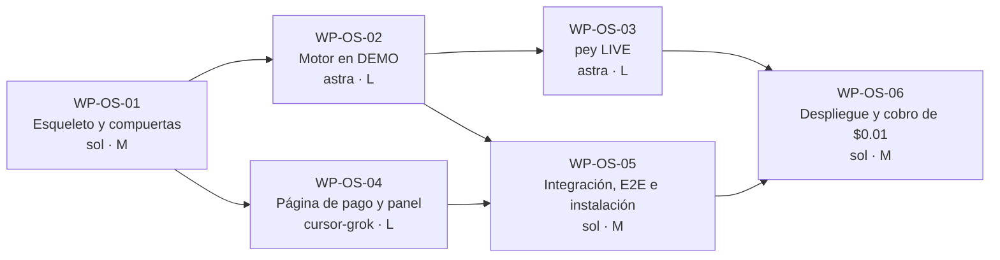

# PLAN — PAYVRO OS

Written 2026-11-14, 12:30 CDMX. All times are CDMX.
One file per work package in `docs/wp/`. This file is the order, the owners and the checkpoints.

## Milestones

| | Date | What exists |
|---|---|---|
| **M1 · Base** | Sun 2026-11-15, 13:00 | Public repo, a live DEMO anyone can click through, and one real $0.01 CoDi charge on the event's test accounts verified against pey and released. Template "Pedido que se libera". Form submitted. |
| **M2 · Producto completo** | ~Sat 2026-11-28 | Webhook + listing sweep, review queue, Mostrador with CoDi QR, templates 2 and 3, hardening, engine tagged for Cloud, agent access. |
| **M3 · Entrega nacional** | Sat 2026-12-12 | Production with a real business's own CLABE (if one is found and activated), privacy notice, final video, end-to-end build diary. |

## M1 — six work packages, ~24 hours

| WP | Title | Lane | Reviewers | Depends on | Size | Target (CDMX) |
|---|---|---|---|---|---|---|
| WP-OS-01 | Esqueleto, compuertas y contrato | sol | sonnet | — | M | Sat 15:00 |
| WP-OS-02 | Motor en DEMO: estados, bitácora, idempotencia, simulador | astra | opus, gemini | 01 | L | Sat 19:00 |
| WP-OS-04 | Página de pago y panel "Pedido que se libera" | cursor-grok | sonnet, gemini | 01 | L | Sat 19:00 |
| WP-OS-03 | pey LIVE: cliente, verificación, sondeo, barrido por intento | astra | opus, gemini | 02 | L | Sat 23:00 |
| WP-OS-05 | Integración, E2E en DEMO e instalación por prompt | sol | sonnet, gemini | 02, 04 | M | Sun 02:00 |
| WP-OS-06 | Despliegue DEMO + LIVE y cobro real de $0.01 | sol + founder | opus | 03, 05 | M | Sun 10:00 |

Buffer: Sun 10:00 → 13:00 for the form, a short video and whatever broke.

### Running order and the machine

The factory runs at most two builders at once and one while a gate runs.

1. **Now:** `sol` starts WP-OS-01. In parallel `cursor-grok` starts WP-CL-01 in the Cloud repo (it depends on nothing here), because today is its last budget day.
2. **When 01 is green:** `astra` starts WP-OS-02 and `cursor-grok` moves to WP-OS-04. They share no writable path: 04 builds against the typed stubs that 01 ships.
3. **When 02 is green:** `astra` continues with WP-OS-03; `sol` takes WP-OS-05 as soon as 04 is also green.
4. **Sunday morning:** WP-OS-06 with the founder present: it creates cloud resources and moves real (tiny) money, so every step that spends or charges needs his OK.

Stacking: a dependent WP may branch from its predecessor's branch once that branch passes `npm run gate` and has a reviewer verdict, without waiting for the merge. Merges to `main` happen in dependency order, each with `VISTO-BUENO <sha>`. This is the orchestrator's call per WP; the default is to stack, because waiting for six sequential approvals does not fit in 24 hours.

### If M1 slips — cut in this order

1. Drop the listing sweep and the webhook (already outside M1).
2. WP-OS-04 loses `/panel/ajustes` and the bitácora timeline; the panel keeps the table and "Nuevo cobro".
3. LIVE runs locally (ADR-0007) instead of on a second Vercel deployment; the $0.01 charge is recorded on video.
4. Last resort: submit with the DEMO link only and the LIVE charge shown in the video. Never cut: record-before-call, GET-is-truth, the bitácora, DEMO/LIVE separation.

If `cursor-grok` runs out of budget before WP-OS-04 is done, `sol` finishes it from the same WP file; nothing else changes.

### M1 exit checklist (the founder ticks these)

- [ ] `main` of `GNOSIXSI/payvro-os` is public, `npm run gate` green in CI on the head commit.
- [ ] DEMO URL: a stranger creates a cobro, simulates the payment and sees "Pago verificado" and "Liberado" in under a minute.
- [ ] LIVE: one $0.01 charge on an event test account went `esperando_pago → pagado_verificado → liberado`, and the bitácora shows the chain with pey ids.
- [ ] `git log -p` on `main` has no secret, CLABE, personal name of a test account holder, personal email, session link or tool trailer (`npm run secrets` + a manual read).
- [ ] README says what it is, how to try the DEMO, the install prompt and the license.
- [ ] Form sent: team, description, repo, live link, emails (and video if recorded).

## M2 — ordered backlog (~28-Nov)

| WP | Title | Lane | Reviewers | Depends on | Size |
|---|---|---|---|---|---|
| WP-OS-07 | Timbre y barrido por listado: webhook firmado y cursor de transacciones | astra | opus, gemini | 03 | M |
| WP-OS-08 | Cola de revisión, expiración, cancelación y pausa de cobros | sol | opus, gemini | 03 | M |
| WP-OS-09 | Mostrador: QR CoDi de precio fijo con varios pagos | sol | sonnet, gemini | 07 | L |
| WP-OS-10 | Endurecimiento: límites, CSP, auditoría de dependencias, redacción de logs | sol | opus, gemini | 05 | M |
| WP-OS-11 | Motor versionado: manifiesto, etiqueta y contrato para Cloud | sol | sonnet | 07 | S |
| WP-OS-12 | Plantillas "Anticipo de cita" y "Cotización que arranca" | sol | sonnet, gemini | 08 | L |
| WP-OS-13 | Acceso para agentes: tokens con alcance mínimo y API de cobros | astra | opus, gemini | 08, 10 | L |

WP-OS-07 is first: it closes the two gaps M1 leaves open (lost-event recovery by listing, and the doorbell). WP-OS-11 unblocks Cloud's vendoring (WP-CL-03) and should land as early as the engine is stable.

After the listed ones, not yet written as WPs: the "fábrica de encargos" live screen for the demo day, notifications to the pagador, export of the day's cut, and the MCP hookup (the MCP lives in its own repo and talks to the API of WP-OS-13).

## M3 — to 12-Dec

Not packaged yet; they depend on answers from pey and the founders (see below).
- First real business: its own pey account and CLABE (`ACTIVE` takes up to 5 business days → must start by **Fri 2026-12-04** at the latest; earlier is better).
- Privacy notice page and data-minimization review.
- Final QA pass in a browser on the production URL; final video; build diary closed.
- Publish `motor-v1.0.0`.

## Gates (every PR)

`npm run gate` = typecheck → lint → unit and convex-test → build → Playwright E2E in DEMO → gitleaks. Plus: each new test seen failing first, reviewer from another vendor, founder's `VISTO-BUENO <sha>` to merge. Details: `AGENTS.md` §3.

## Open questions that change this plan

Facts we do not have yet. Each names who can answer and what it blocks.

| # | Question | Who | Blocks |
|---|---|---|---|
| 1 | Can a pey payment link be limited to CoDi? The API has no such field and the example lists `CARD`. Today a card payment goes to `en_revision`. | pey | Verification policy |
| 2 | pey rate limits. The sondeo polls every 1.5–2 s per watched cobro. | pey | WP-OS-03 defaults |
| 3 | How is a webhook endpoint registered, and are the event names in `CONTEXT.md` §6 current? | pey / docs.pey.mx | WP-OS-07 |
| 4 | Does a transaction name its receiving account anywhere? | pey | Stronger destination check |

## Risks

| Risk | Signal | Response |
|---|---|---|
| Event test accounts behave differently from the spec | First LIVE GET returns an unexpected shape | Schema validation fails closed → cobro stays `esperando_pago`; record the real shape in `CONTEXT.md`, adjust `cliente.ts`. |
| pey throttles polling | 429 during the sondeo | Back-off is built in; raise the interval; rely on the sweep. |
| A builder touches the engine and the UI in one PR | Diff crosses `ARCHITECTURE.md` §3 boundaries | Reviewer blocks; split. |
| Secrets or test-account data leak into the public repo | gitleaks hit, or a CLABE-shaped number in a diff | Stop, rotate at the provider, rewrite the branch before it is merged. Never "fix forward" on `main`. |
| DEMO deployment is abused | Row count spikes | Rate limit + 24 h purge are in WP-OS-02; pause the deployment if needed. |
| Shared Convex dev deployment between worktrees | A builder's functions disappear mid-run | One dev deployment per worktree (`AGENTS.md` §8). |
